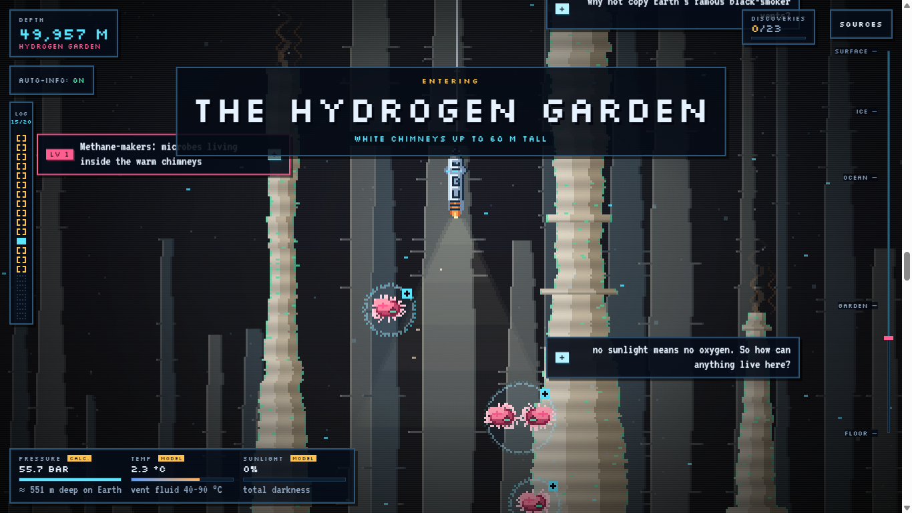
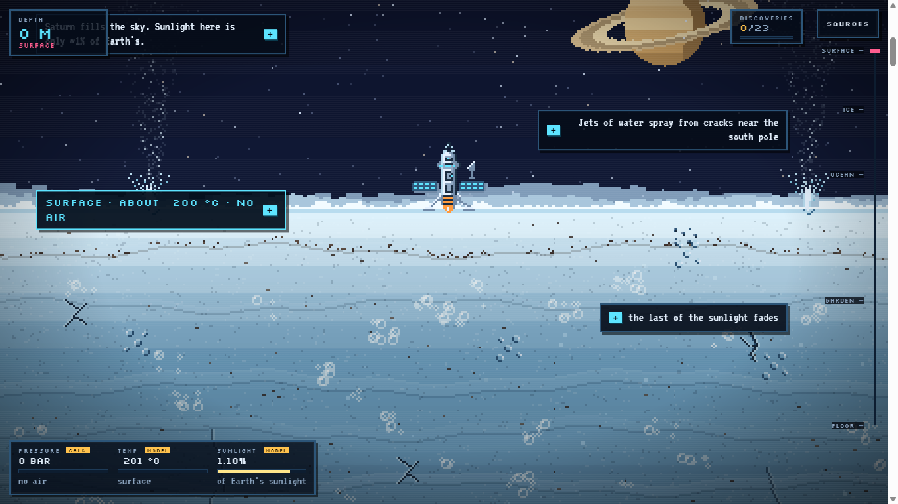
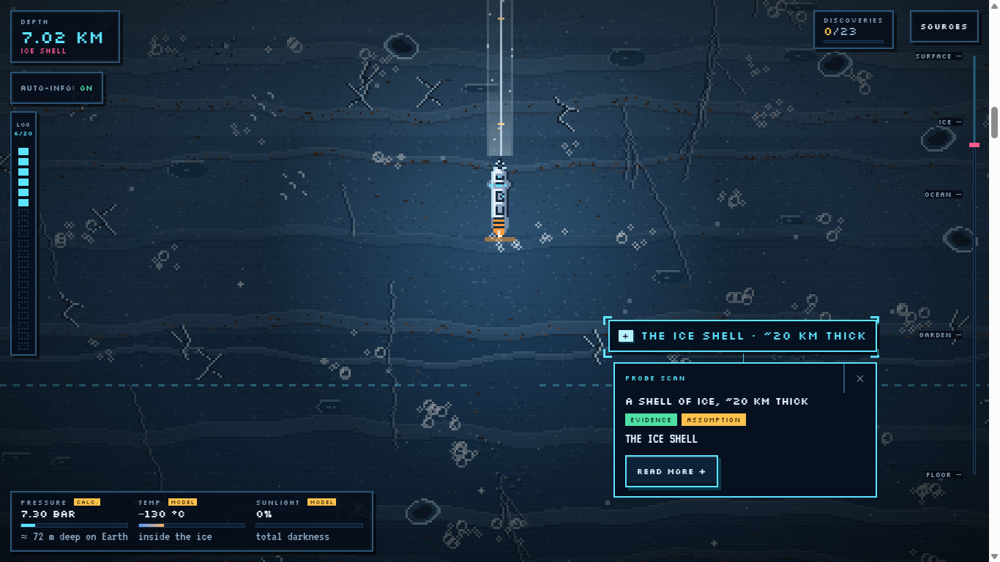
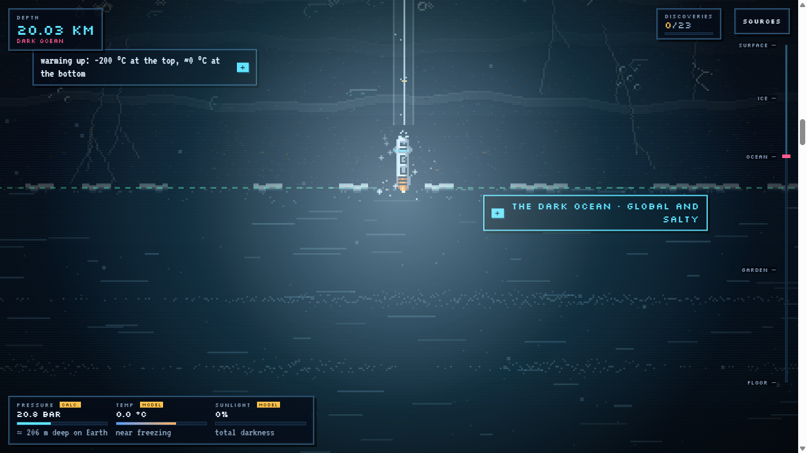
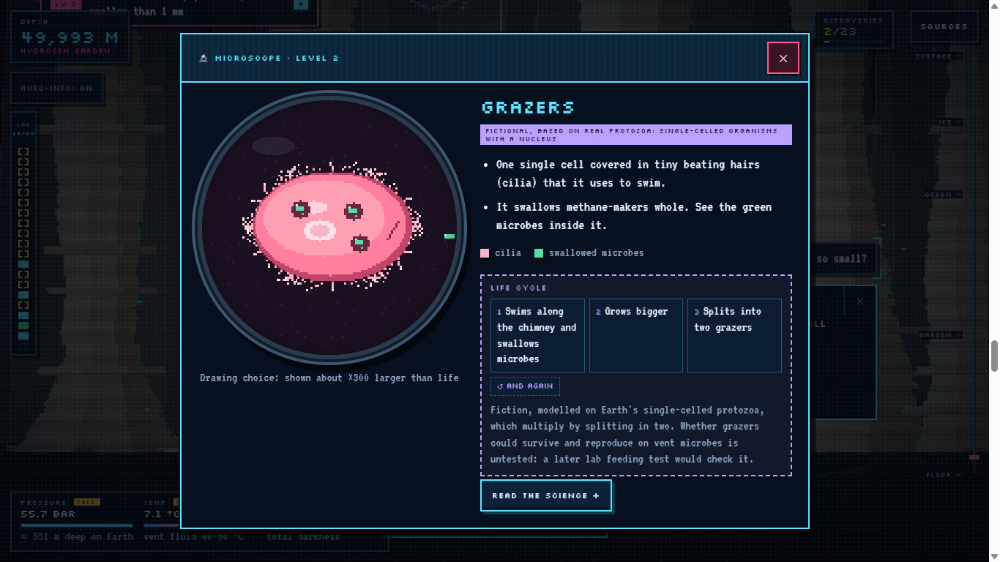
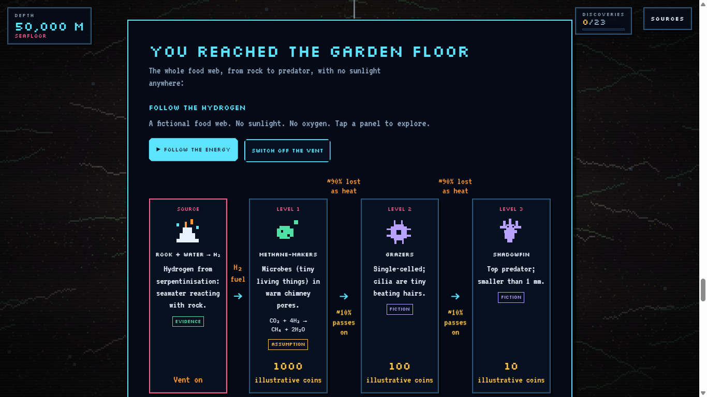
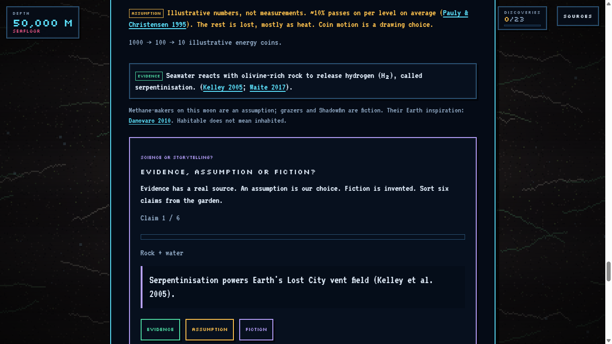
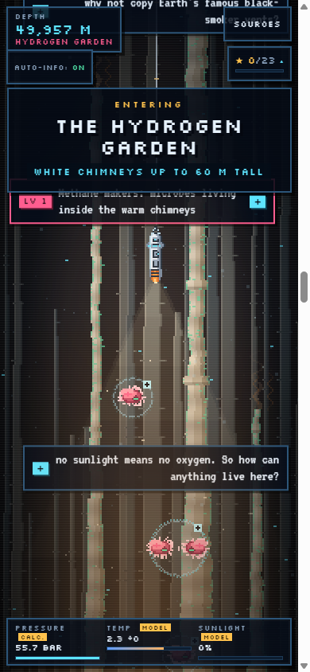
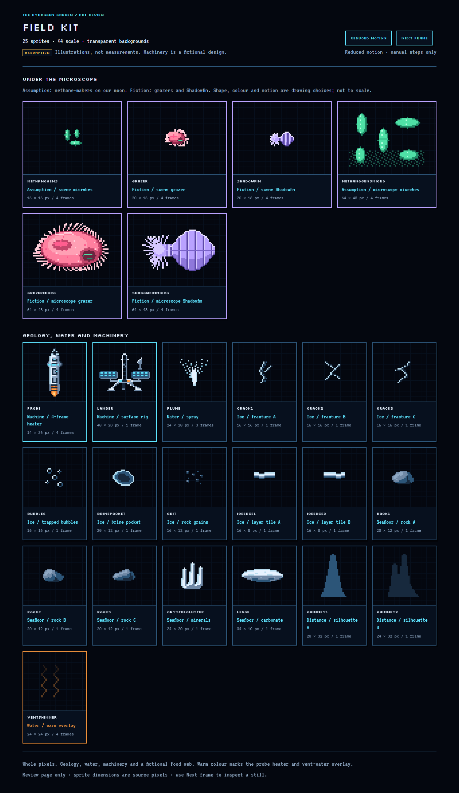

<div align="center">

## 🔗 [**Live website → omarshobaki-png.github.io/Pyrothalasa**](https://omarshobaki-png.github.io/Pyrothalasa/)

# 🌊 The Hydrogen Garden

### Dive 50 km into a fictional ocean moon where life runs without sunlight.

**Team Shay Rafe3** · NOVA for Astronomy and Space Science · Challenge A: *Life Without Sunlight*
<br>(adapted from NASA Space Apps 2024, "Beyond Sunlight")

[](https://omarshobaki-png.github.io/Pyrothalasa/)
[](https://drive.google.com/file/d/1dLfS1ZW1qGngDrTg4QJEw0VGyg4zmLMQ/view?usp=sharing)
[](ShayRafe3_Challenge-A_Report.pdf)



</div>

---

## 🪐 What is this?

**Pyrothalasa** is a fictional icy moon of Saturn, modelled on the real moon **Enceladus**. Under 20 km of ice
and 30 km of salty ocean lies the **Hydrogen Garden**: a field of white carbonate chimneys like Earth's
**Lost City** vents. There's no sunlight down there, and our model assumes no oxygen. Instead, life runs on
**hydrogen** released when seawater reacts with rock.

This website lets you **ride a melting probe from the frozen surface to the garden floor**, one scroll at a
time. The probe scans what it passes, and you meet the three levels of an invented, oxygen-free food web.
Along the way you can test what you've learned.

> **Habitable does not mean inhabited.** Pyrothalasa and its creatures are fictional. Every design choice is
> tied to real evidence, and the site labels every claim so readers can tell science from storytelling.

Built for **students aged 14–18 and their science teachers**. Plain words, with each science term defined
the first time it appears.

---


## 📖 Key words

New to the science? Here is what the main words mean.

- **Hydrothermal vent:** a crack in the seafloor where warm, mineral-rich water flows out.
- **Serpentinisation:** a reaction between seawater and certain rocks (like olivine) that releases hydrogen gas.
- **Chemosynthesis:** making food from chemical energy instead of sunlight.
- **Methane-makers (methanogens):** microbes that combine hydrogen and carbon dioxide for energy, releasing methane.
- **Food web level:** one step in who-eats-whom. Only about 10% of the energy passes to the next level.
- **Anaerobic:** living without oxygen.

---

## 🔬 Science you can trust: every claim is labelled

Every card, callout and widget tags its claims with one of three labels:

| Tag | Meaning | Example |
|---|---|---|
| 🟩 **Evidence** | A real, cited source says it | Cassini detected H₂ in Enceladus' plume (Waite et al. 2017) |
| 🟧 **Assumption** | A modelling choice we made | Garden water is about 8 °C; the 1000 → 100 → 10 energy coins are illustrative |
| 🟪 **Fiction** | Invented for this world | The grazers and Shadowfin, based on real Earth organisms |

The HUD gauges carry their own `CALC.` and `MODEL` badges, so even live numbers say where they come from.

---

## 🎮 Take the tour

<table>
<tr>
<td width="50%">

**1 · The surface**<br>
Saturn fills the sky. Jets of water spray from cracks near the south pole. The lander drops the probe
into the ice.

</td>
<td width="50%">

**2 · The ice shell (0–20 km)**<br>
The probe melts its way down, trailing its cable. As it passes each feature it **scans it automatically**:
a beam, target brackets, and a callout that types itself out.

</td>
</tr>
<tr>
<td></td>
<td></td>
</tr>
<tr>
<td>

**3 · Breaking into the dark ocean (20 km)**<br>
A flash as the probe breaks through. Sonar pings, drifting sediment, and total darkness apart from the
probe's lamp.

</td>
<td>

**4 · The Hydrogen Garden (50 km)**<br>
White chimneys up to 60 m tall, warm vent water, and the three food-web levels, drawn about ×300 larger
than life.

</td>
</tr>
<tr>
<td></td>
<td></td>
</tr>
<tr>
<td>

**5 · Under the microscope**<br>
Tap a creature to zoom in: its anatomy, its life cycle, and what is evidence versus fiction.

</td>
<td>

**6 · Follow the energy**<br>
An animated food web: hydrogen → methane-makers → grazers → Shadowfin. Watch about 90% of the energy
turn into heat at each step, then switch off the vent and see the food web collapse from the bottom up.

</td>
</tr>
<tr>
<td></td>
<td></td>
</tr>
<tr>
<td>

**7 · Science or storytelling?**<br>
A mini-game: sort real claims from the site into Evidence, Assumption or Fiction. Each answer reveals its
source.

</td>
<td>

**8 · Works on phones**<br>
The whole dive works at phone width: callouts become bottom sheets, and every control has a touch target
of at least 44 px.

</td>
</tr>
<tr>
<td></td>
<td align="center"></td>
</tr>
</table>

---

## 🍎 For teachers: a 20-minute lesson

A suggested way to use the dive in one class period.

| Time | Step | What students do |
|---|---|---|
| 2 min | Before quiz | Tap "Take the 30-second quiz first" on the opening screen |
| 8 min | The dive | Scroll to the garden floor, opening at least five **+** labels and one creature under the microscope |
| 3 min | Follow the energy | Press "Follow the energy", then "Switch off the vent" and watch what happens |
| 3 min | Science or storytelling? | Sort the six claims into Evidence, Assumption or Fiction |
| 2 min | After quiz | Take the quiz again and compare scores |
| 2 min | Discuss | Use the questions below |

**Questions to discuss**

1. Trace the energy from the rock to Shadowfin. Where does most of it go at each step?
2. Pick one condition in the garden (darkness, no oxygen, pressure, warmth). How does it shape what can live there?
3. What happens to each level if the hydrogen stops? Which level goes first, and why?
4. Find one claim on the site that is fiction. Which real Earth example inspired it?
5. Why does "habitable" not mean "inhabited"?

---

## ✨ Features

- **Scroll-driven dive.** A pixel-art canvas world 50 km deep, with live depth, pressure, temperature and
  sunlight gauges.
- **Automatic probe scans.** Info appears by itself as the probe reaches it. Fast scrollers aren't flooded:
  skipped items go to a **mission log** to read later.
- **Zone banners** mark each chapter of the dive: the ice shell, the dark ocean, the Hydrogen Garden.
- **20 science cards**, each with its evidence, assumptions and sources.
- **Microscope view** of all three food-web levels, with animated life cycles.
- **Interactive energy flow**, with "Follow the energy" and "Switch off the vent".
- **Evidence / Assumption / Fiction game**, which teaches the habit the whole project is built on.
- **Before/after quiz** for our classroom user test. Answers aren't revealed before the dive, so the before
  score is a fair baseline, and testers can copy their results to send to the team.
- **Discoveries counter (0/24)** that rewards exploring, plus a "what you missed" list at the end.
- **Hand-made pixel art**: a 4-frame melting probe, lander, plumes, ice fractures, carbonate ledges and
  creature sprites, all drawn in code. [Sprite sheet ↓](#-pixel-art)

---

### Why hydrogen, and not something else?

We tested three other ways to power the garden. Each failed the same question: *if the Sun switched off, would it still work?*

| Idea we rejected | Why it's tempting | Why it fails here | Source |
|---|---|---|---|
| Copy Earth's black-smoker vents (tubeworms + sulfide-eating bacteria) | Best-known example of life without light | Those bacteria need oxygen (CO₂ + 4H₂S + O₂ → CH₂O + 4S + 3H₂O), and Earth's deep-sea oxygen comes from sunlit plants and algae | [NOAA fact sheet](https://oceanexplorer.noaa.gov/edu/materials/chemosynthesis-fact-sheet.pdf) |
| Plants or algae under thin ice | Photosynthesis is what students already know | Sunlight at Saturn is about 1% of Earth's, and it can't get through kilometres of ice | [NASA: Saturn facts](https://science.nasa.gov/saturn/facts/) |
| Methane-eating microbes, like at Earth's cold seeps | Our garden is full of methane | They need oxygen or sulfate to use methane, and we have no evidence the garden has either. Here methane is the waste, not the food | [Boetius et al. 2000](https://doi.org/10.1038/35036572) |

**Every rejected idea secretly depended on the Sun.** Hydrogen from rock and water is the only option that doesn't, so that's what the garden runs on.

---

## 🧪 The science at a glance

| | Our model | Basis |
|---|---|---|
| **Energy source** | H₂ from seawater reacting with olivine-rich rock (*serpentinisation*) | Lost City (Kelley 2005); H₂ in Enceladus' plume (Waite 2017) |
| **First living level** | Methane-makers: **CO₂ + 4H₂ → CH₄ + 2H₂O** | Methane made under Enceladus-like conditions in the lab (Taubner 2018) |
| **Food web** | Methane-makers → single-celled grazers → **Shadowfin** (< 1 mm) | Oxygen-free protozoa and Loricifera (Danovaro 2010; debated: Bernhard 2015) |
| **Energy transfer** | ~10% passes on per level; 1000 → 100 → 10 coins (illustrative) | Pauly & Christensen 1995 |
| **Habitat** | 50 km down (20 km ice + 30 km ocean), ~56 bar, pH 9–11, vent fluid ~40–90 °C | Thomas 2016; Kelley 2005; pressure calculated |
| **Oxygen** | Negligible: a **model assumption** | No photosynthesis at depth |
| **If the vent stops** | Methane-makers starve first, then grazers, then Shadowfin | Vents are short-lived (NOAA) |

### Limits we're honest about
- Whether any life exists on a real ocean world remains an open question. Our organisms are invented.
- We assume enough CO₂ reaches the same pores as H₂. Some Lost City fluids are carbon-poor (Brazelton 2006).
- Nobody knows yet whether grazers or a Shadowfin-like predator could live in salty, oxygen-free water.
- The 10% rule is an Earth average. The gauges use simplified physics: constant gravity, a straight-line
  ice temperature, and an illustrative light fade.

### How it could be tested
- **Lab check:** grow Earth methane-makers in warm, salty, oxygen-free chambers at about 56 bar, with and
  without H₂ (Taubner et al. 2018).
- **Classroom check:** five students aged 14–18 take the quiz before and after the dive. The goal is that
  four of the five can trace the energy path.
- **In a real vent:** finding H₂ and dissolved CO₂ together in warm, oxygen-free water would make the
  habitat more plausible.

---

## 🎨 Pixel art

All the art is drawn in code as pixel maps, with no image files. Each sprite is cached after the first
draw, so the whole scene stays light enough for phones.



Open [`docs/sprite-preview.html`](docs/sprite-preview.html) to see the sprites animate.

---

## 🚀 Run it locally

There's no build step and nothing to install.

```bash
# Option 1: just open it
double-click index.html

# Option 2: serve the folder
npx http-server -p 8917 -c-1 .
# then open http://localhost:8917
```

Plain **HTML + CSS + vanilla JavaScript**: no frameworks, bundlers or npm dependencies. Fonts come from
Google Fonts; without internet the page falls back to a monospace font.

---

## 🗂 Project structure

| File | What it does |
|---|---|
| `js/content.js` | **All the science**: card text, labels, gauge numbers, limits, tests and sources (`window.DIVE`) |
| `js/app.js` | Scroll camera, depth mapping, HUD gauges, probe scans, cards, mission log |
| `js/world.js` | The pixel-art canvas world: surface, ice, ocean, garden |
| `js/sprites.js` | Pixel-art sprite library (`window.Sprites`) |
| `js/microscope.js` | Zoomed, animated view of each food-web level |
| `js/energyflow.js` | Interactive energy-flow diagram |
| `js/taggame.js` | Evidence / Assumption / Fiction mini-game |
| `js/quiz.js` | Before/after quiz for the user test |
| `css/` | Design system (`style.css`) plus one stylesheet per widget |
| `docs/` | Challenge brief, science lead guide, report outline and screenshots |
| `ShayRafe3_Challenge-A_Report.pdf` | The 4-page concept report |

---

## ♿ Accessibility & performance

- **Keyboard:** every marker, card, widget and dialog works with Tab, Enter and Escape. Focus is always
  visible, and the dive scrolls to whatever has focus.
- **Reduced motion:** when the system setting is on, animations, flashes, parallax and typing effects are
  turned off, and everything still works.
- **Contrast:** text colours checked against WCAG AA.
- **Touch:** targets are at least 44 px. Tested at 360, 390 and 1366 px wide with no horizontal scroll.
- **Screen readers:** probe scans are announced through a polite live region.
- **Performance:** static art is pre-drawn once. Scene drawing takes about 4–6 ms per frame with the CPU
  slowed 4×.

---

## 👥 Team Shay Rafe3

| Member | Role | What they did |
|---|---|---|
| Omar Shoubaki | Science and research lead | Researched serpentinization and Cassini's hydrogen finding; chose hydrogen over three alternatives |
| Ahmad Sulieman | Evidence and validation lead | Wrote the limits and the lab/classroom checks; checked each citation against its source |
| Omar Takhman | Science co-lead | Researched and wrote the three rejected alternatives; Video script and animation |
| Alameen Abufkheida | Ecology lead | Designed the three food-web levels and Shadowfin; wrote sections 2 and 4 |
| Mahdi Alsheikh | Video specialist | Edited the 3-minute video in After Effects; added the ElevenLabs narration |
| Mohammad Humidan | Web developer | Programmed the dive: gauges, switch-off-vent button and quizzes |

**AI use:** ChatGPT (Codex) helped with writing and formatting the report. Claude reviewed the report
against the rubric. Claude Code assisted with programming and ElevenLabs with narration audio. Mahdi edited
the video in Adobe After Effects.

---

## 📚 Key sources

- Waite, J. H. et al. (2017). Cassini finds molecular hydrogen in the Enceladus plume. *Science*, 356, 155–159.
- Kelley, D. S. et al. (2005). A serpentinite-hosted ecosystem: The Lost City hydrothermal field. *Science*, 307, 1428–1434.
- Früh-Green, G. L. et al. (2003). 30,000 years of hydrothermal activity at the Lost City vent field. *Science*, 301, 495–498.
- Taubner, R.-S. et al. (2018). Biological methane production under putative Enceladus-like conditions. *Nature Communications*, 9, 748.
- Danovaro, R. et al. (2010). The first Metazoa living in permanently anoxic conditions. *BMC Biology*, 8, 30.
- Bernhard, J. M. et al. (2015). Metazoans of redoxcline sediments in Mediterranean deep-sea hypersaline anoxic basins. *BMC Biology*, 13, 105.
- Pauly, D. & Christensen, V. (1995). Primary production required to sustain global fisheries. *Nature*, 374, 255–257.
- Thomas, P. C. et al. (2016). Enceladus's measured physical libration requires a global subsurface ocean. *Icarus*, 264, 37–47.
- Brazelton, W. J. et al. (2006). Methane- and sulfur-metabolizing microbial communities dominate the Lost City hydrothermal field ecosystem. *Applied and Environmental Microbiology*, 72, 6257–6270.

The full list of 21 sources, with links, is in the site's **Sources** panel and in [`js/content.js`](js/content.js).

<div align="center">
<br>
<sub>Pyrothalasa is fictional. The science behind it is real.</sub>
</div>
